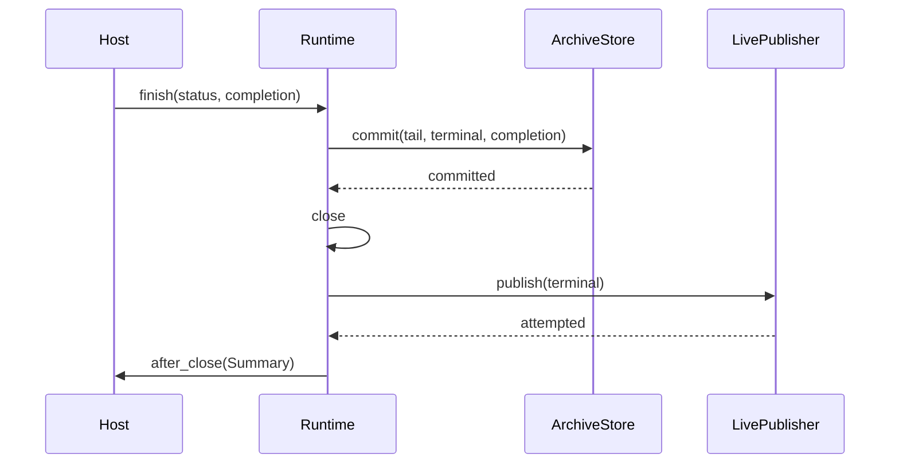

# Architecture and extensions

[简体中文](architecture.md) · [Documentation](README.en.md)

| Port | Owns | Does not own |
| --- | --- | --- |
| `EventCodec` | Business/terminal construction and LIVE/ARCHIVE encoding | I/O or mutation of accepted events |
| `LivePublisher` | Execution-bound publication; may return a new receipt-bearing event | Business-content changes or result transactions |
| `ArchiveStore` | `checkpoint`, activity updates, atomic `commit` | Permissions, scheduling, automatic redelivery |

`StreamRuntime` coordinates bounded buffering, serialized calls, degradation, and closure. The host supplies execution identity and fencing, true transaction boundaries, result types, and snapshot representation.
The core knows no Redis key/TTL/read operations. `after_close` receives a frozen Summary once and cannot participate in the transaction.

## Completion order

| Condition | Result |
| --- | --- |
| `commit` succeeds | Tail, terminal, and result are committed atomically before closure and live/observer attempts |
| `commit` raises | Propagate; retain pending/open state; no terminal publication or notification |
| Publication/notification fails after commit | Isolate ordinary exceptions; the durable result cannot be undone |

`send` constructs and validates, publishes, encodes for archive, then buffers. Archive encoding may fail after a live receipt, so encoding must be deterministic and free of I/O. Never mutate accepted events or nested data.
Only successful checkpoints clear pending. Only configured infrastructure errors degrade; fencing and programming errors propagate. Integrity only advances COMPLETE → DEGRADED → TRUNCATED.

Editable GitHub sequence

Counter uses dataclasses, text frames, and an in-memory latest-value snapshot. The SQLite Demo owns its events and transactions. Both compose public ports only.
JSON/Pydantic, Redis, the Redis-only reader/SSE, and JSON-prefix helpers are optional profiles, not a generic reader for arbitrary channels.
See [API](api.en.md) and [types.py](../src/ui_stream/types.py).
