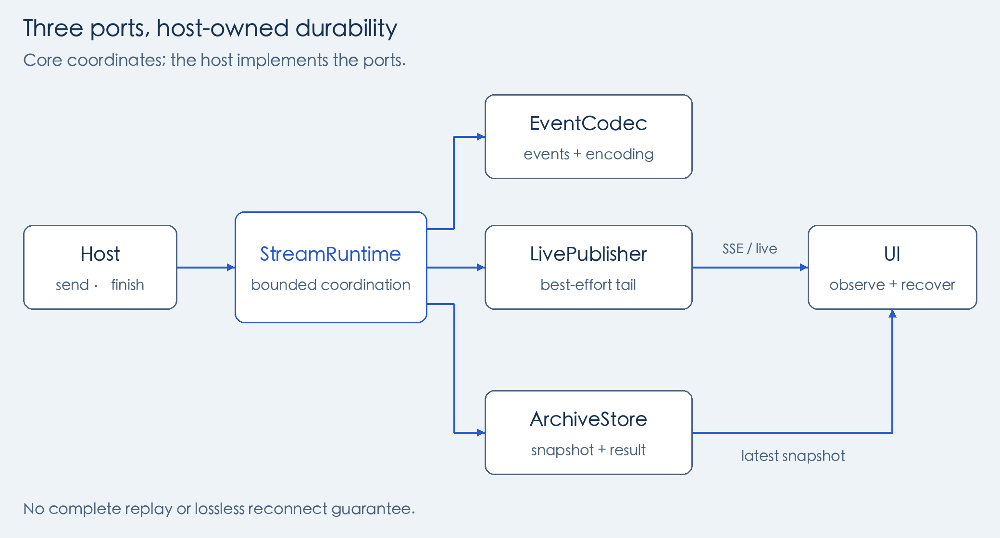
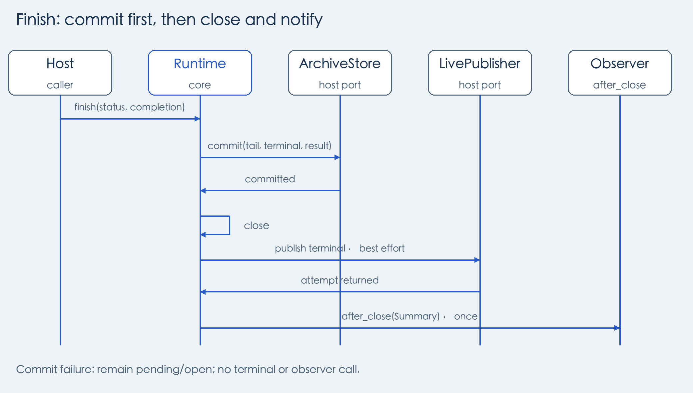
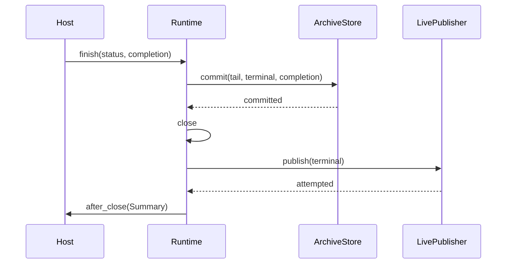

# Architecture and integration

[简体中文](architecture.md) · [Documentation](README.en.md)

Start with the complete [Counter implementation](../examples/counter.py): a task sends progress values 4 and 9, storage retains latest value 9, and completion commits business result 13. Real tasks use the same Runtime call order with different events, channels, and storage.

## Understand the data first

| Concept | Meaning here |
| --- | --- |
| Host | The application using ui-stream, which already owns scheduling, user permissions, and business storage. |
| Execution | One particular run of a task; the host decides whether retries or replacements receive a new execution ID. |
| Business event | One progress update, possibly data used to update a snapshot; it need not be JSON. |
| pending | Runtime's buffer of events not yet successfully handled by the archive port, not durable history. |
| checkpoint | Passing the whole pending batch to storage to update progress; it does not make computation resumable. |
| Snapshot / final result | A snapshot restores current UI progress; the final result is the task's business output, passed to storage as `completion`. |

A snapshot may be a latest value, accumulated state, or a bounded event list. It need not retain all history. `Integrity` tracks failures or truncation in progress history separately from business success/failure: a task may succeed even though some live progress was unavailable.

## Assemble three ports

A “port” is an implementation object with agreed methods. Your classes can satisfy the [Protocols](../src/ui_stream/types.py) without inheriting Runtime or the default event class; explicitly inheriting a Protocol is also available for IDE visibility. Assembly types can be imported from `ui_stream`, while their contracts remain defined in `ui_stream.types`.

| Object | Implement | How Runtime uses it |
| --- | --- | --- |
| `EventCodec` | `business(data)`, `terminal(status)`, `reset(reason)`, `encode(event, target)` | Construct progress/terminal/reset events, validate and measure bytes, without backend I/O. |
| `LivePublisher` | `publish(event)` | Publish synchronously; return a new receipt-bearing event if the backend generates a message ID. |
| `ArchiveStore` | `checkpoint(...)`, `touch_activity(...)`, `commit(...)` | Save progress batches, refresh activity, and atomically save the tail, terminal event, and result at completion. |

The host creates an execution, combines resource/task/execution IDs into a `Binding`, and supplies it to Runtime. Storage must verify that this execution may still write and reject replaced executions. This is **fencing: isolating stale writers**. It prevents old tasks from overwriting new results; user authorization, scheduling, and snapshot queries remain host responsibilities.

## From progress to a committed result

1. The task repeatedly calls `send(data)`. Runtime constructs an event, validates its LIVE encoding, attempts publication, then measures its ARCHIVE encoding and buffers it. The representations may differ: archive data can include an ID obtained only after publication.
2. A pending count, byte, or activity-time threshold triggers a synchronous `checkpoint`. Only success clears the batch. Configured storage failures retain the buffer and record degradation; subsequent events can trigger recovery. Time checks are event-driven, with no background thread during idle periods.
3. After computing the result, the task calls `finish(status=..., completion=...)`; the sequence below commits before notification.

One Runtime lock covers these calls and port I/O, so business threads may wait for publication or database operations. Same-thread callbacks may read properties. Before commit, while the instance remains open, nested writes raise `ReentrantStreamOperation` to prevent reordered publication or a lost archive tail. A port must not block waiting for another thread to call a method or property requiring the same lock; reading `pending_count`, `closed`, or `archive_status` can also create that deadlock. The lock cannot establish order or execution isolation across instances or processes. Do not mutate events or nested data after passing them to Runtime; codecs and publishers follow the same convention.

If a reentry error escapes an outer operation after entering a potentially writing port, Runtime records DEGRADED and still propagates it; a later successful finish preserves that status. Reentry before I/O in the policy/initial encoding does not degrade, nor does a host-handled inner rejection followed by a successful outer operation.

DEGRADED records an observed failure or uncertainty about completeness, not confirmed data loss; this includes reentry inside the final commit. Runtime cannot determine whether a callback ran before or after the transaction committed. Ordinary commit errors still propagate and retain the open state without additional degradation.

| Condition | Subsequent behavior and reason |
| --- | --- |
| `commit` succeeds | Storage has committed tail, terminal event, and result in one transaction. Runtime then closes and attempts live completion, so notified readers can already read the result. |
| `commit` raises | Propagate, retain pending and open state, and send no live terminal or observer notification. The host checks the commit outcome before deciding to retry. |
| Terminal publication fails after commit | The instance is already closed, so send from the terminal publisher callback raises the closed error first. The outer finish catches notification `Exception`, returns normally, and degrades memory integrity without undoing/repeating the commit or writing that degradation back to storage. |
| `after_close` observer fails | Catch `Exception` and log it so a completed commit is not reported as needing retry. The observer receives a body-free `Summary` outside the lock. |

Publication and database commit are separate operations, not an automatic cross-system transaction. Timeouts may leave writes uncertain, so hosts also design retry idempotency. An execution ID or process lock alone does not provide exactly-once delivery. See the [API](api.en.md) for capacity and per-stage failure rules.

Editable GitHub sequence

## Replacing an execution

The host commits execution rotation and fences the previous writer before calling the new Runtime's `announce_replacement(previous_publisher)`. The new codec constructs reset, while the previous publisher chooses the old channel. Configured publication failures return False and degrade the new Runtime; construction/encoding errors propagate. The host owns transactions, retry decisions, and reader state checks when a notification is missed. See [API](api.en.md) and [migration](migration.en.md).

## UI reads and recovery

Runtime coordinates writes. The library has no generic snapshot-query or archive-replay port. Hosts expose read endpoints, load snapshots/results on open or reconnect, follow live events, and handle gaps according to their cursor and retention policy.

The [SQLite Demo](../demos/sqlite/README.en.md) demonstrates this with custom JSON events, integer cursors, a memory tail, and SQLite. It does not use the optional Pydantic/Redis modules. The default [Redis reader and SSE encoder](api.en.md) use default `Event` objects and Redis-format cursors and cannot directly read the Demo's integer-cursor protocol.
