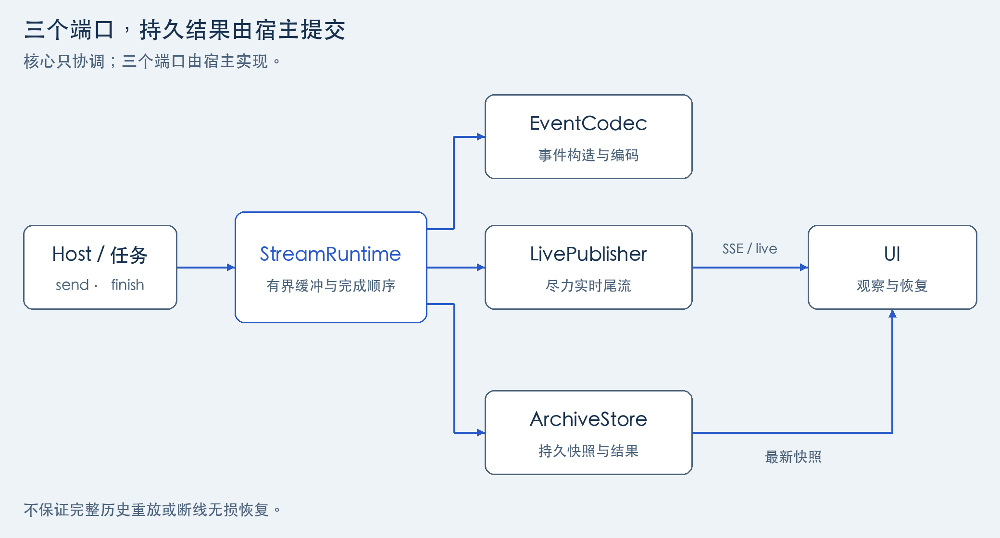
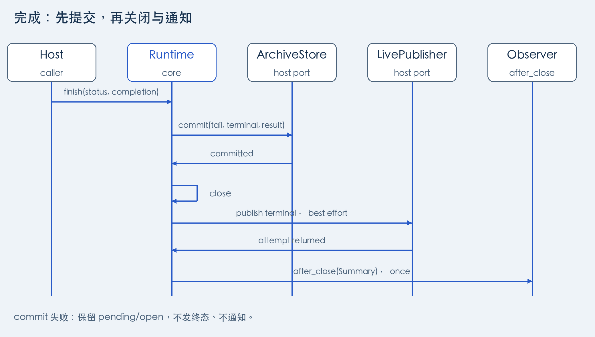
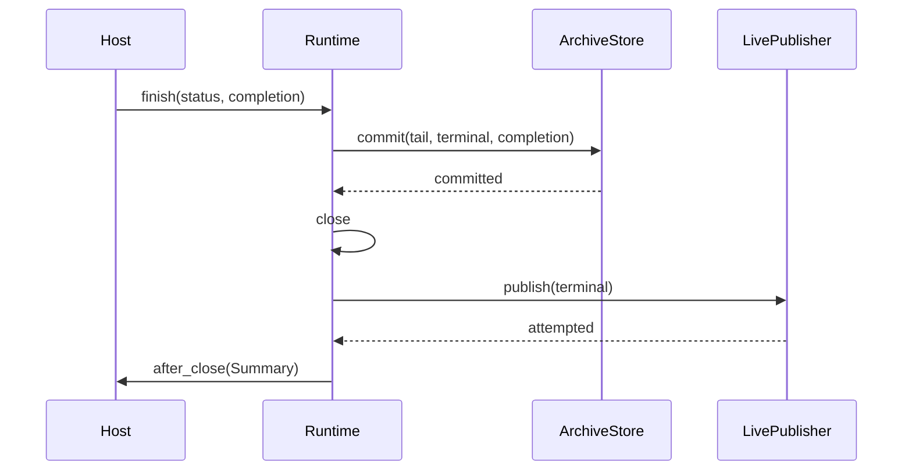

# 架构与接入流程

[English](architecture.en.md) · [文档导航](README.md)

先看 [Counter 的完整实现](../examples/counter.py)：任务发出 4、9 两个进度，存储保存最新值 9，最终提交业务结果 13。换成真实任务时，Runtime 的调用顺序不变，替换事件、通道和存储即可。

## 先理解几份数据

| 概念 | 在这里表示什么 |
| --- | --- |
| 宿主（host） | 使用 ui-stream 的应用，已经拥有任务调度、用户权限和业务存储。 |
| 执行（execution） | 任务的一次具体运行；重试或替换运行时，宿主决定是否分配新的执行 ID。 |
| 业务事件 | 一次进度更新；也可以是更新快照所需的数据，不必是 JSON。 |
| pending | Runtime 内尚未成功交给归档端口的事件缓冲，不是已持久化历史。 |
| checkpoint | 把 pending 整批交给存储端更新进度快照；不表示任务计算可以从这里恢复。 |
| 快照 / 最终结果 | 快照帮助 UI 恢复当前进度；最终结果是任务结束时的业务产物，由 `completion` 传给存储。 |

快照可以是最新值、累计状态或有界事件列表，不一定保存全部历史。`Integrity` 记录进度历史是否曾故障或被截断，和任务成功/失败是两件事：任务可以成功，但部分实时进度曾不可用。

## 组装三个端口

“端口”就是约定好方法的实现对象。可用自己的类满足 [Protocol](../src/ui_stream/types.py)，无需继承 Runtime 或默认事件类。

| 对象 | 需要实现什么 | Runtime 怎样使用它 |
| --- | --- | --- |
| `EventCodec` | `business(data)`、`terminal(status)`、`encode(event, target)` | 构造进度/终态事件，校验并计算字节数，不做后端 I/O。 |
| `LivePublisher` | `publish(event)` | 同步发布事件；若后端生成消息 ID，可返回带回执的新事件。 |
| `ArchiveStore` | `checkpoint(...)`、`touch_activity(...)`、`commit(...)` | 保存批量进度、刷新活动时间，并在结束时原子保存归档尾部、终态和结果。 |

宿主先创建 execution，把资源、任务和执行 ID 组成 `Binding`，再传入 Runtime。存储端要在写入时确认这次执行仍有资格写入，拒绝被替换的旧执行，这称为 **fencing（旧执行写入隔离）**。它避免旧任务覆盖新结果；用户权限校验、任务调度和快照查询仍由宿主实现。

## 从发送进度到提交结果

1. 任务反复调用 `send(data)`。Runtime 用 codec 构造并按 LIVE 编码校验，尝试实时发布，再按 ARCHIVE 编码计量和缓冲。两种表示可以不同，例如归档保存发布后才获得的消息 ID。
2. pending 达到条数、字节或活动时间阈值时，同步调用 `checkpoint`。成功返回才清空整批；配置的存储故障保留缓冲并记录降级，后续事件还可触发恢复。时间检查由事件驱动，没有空闲时自动运行的后台线程。
3. 任务计算出结果后调用 `finish(status=..., completion=...)`，按下图先提交，再通知结束。

同一 Runtime 的锁覆盖这些调用及端口 I/O，因此业务线程可能等待发布或数据库操作。跨实例、跨进程的顺序与执行隔离不能依靠这把锁。事件及嵌套数据一旦交给 Runtime，就不应继续修改；编码器和发布器也遵守这个约定。

| 情况 | 后续行为及原因 |
| --- | --- |
| `commit` 成功 | 存储端已把尾部、终态和结果放入同一事务提交；Runtime 才关闭并尝试实时终态，确保收到通知时结果已可读取。 |
| `commit` 抛错 | 异常传播，pending 保留、Runtime 未关闭，不发实时终态或观察者通知。宿主确认提交结果后再决定重试。 |
| 提交后的终态发布失败 | 捕获 `Exception`，记录内存完整性降级，不回滚或再提交结果；持久记录不会因此被回写。 |
| `after_close` 观察者失败 | 捕获 `Exception` 并记日志，避免把已完成的提交误报成需要重试。观察者在锁外接收不含事件正文的 `Summary`。 |

实时发布和数据库提交是两次操作，没有自动组成跨系统事务。网络超时可能让写入结果不确定，宿主还需设计重试幂等；只有一次执行 ID 或进程锁，并不等于事件恰好一次投递。容量与各阶段异常的具体规则见 [API](api.md)。

GitHub 可编辑时序

## UI 怎样读取和恢复

Runtime 负责写入协调，库没有通用的快照查询或归档回放端口。宿主提供读取接口，在用户打开或重连时读取快照/结果，再衔接实时事件，并按自己的游标和保留策略处理缺口。

[SQLite Demo](../demos/sqlite/README.md) 用自己的 JSON 事件、整数游标、内存尾流和 SQLite 展示这一过程；它不使用可选 Pydantic/Redis 模块。默认 [Redis reader 与 SSE 编码](api.md) 则使用默认 `Event` 和 Redis 格式游标，不能直接读 Demo 的整数游标协议。
