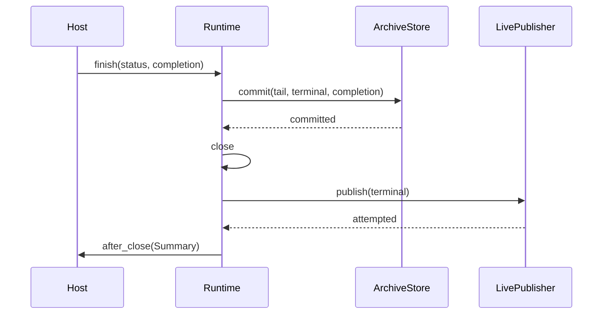

# 架构与扩展

[English](architecture.en.md) · [文档导航](README.md)

| 端口 | 负责 | 不负责 |
| --- | --- | --- |
| `EventCodec` | 构造业务/终态事件；按 LIVE、ARCHIVE 编码 | I/O、修改已接受的事件 |
| `LivePublisher` | 已绑定 execution 的实时发布；可返回带回执的新事件 | 改变业务内容、决定结果事务 |
| `ArchiveStore` | `checkpoint`、活动更新、原子 `commit` | 权限、任务调度与自动重投递 |

`StreamRuntime` 只协调缓冲、串行调用、降级与关闭顺序。宿主提供 execution 身份和 fencing，决定真实事务边界、结果结构与快照表示。
核心无 Redis key/TTL/read 假设；`after_close` 是一次 frozen Summary 通知，不参与事务。

## 完成顺序

| 情况 | 结果 |
| --- | --- |
| `commit` 成功 | 尾部、终态、结果已同事务提交，然后关闭并尝试实时终态与通知 |
| `commit` 抛错 | 异常传播，保留 pending/open，不发终态、不通知 |
| 提交后的终态发布/通知失败 | 隔离普通异常，不能撤销已提交结果 |

`send` 先构造并验证事件，再发布、编码归档并缓冲。回执后的归档编码仍可能失败，因此编码应确定、无 I/O；事件及嵌套数据接受后不得修改。
checkpoint 成功才清 pending；只降级配置的基础设施错误，fencing/实现错误直接传播。完整性只向 COMPLETE → DEGRADED → TRUNCATED 变化。

GitHub 可编辑时序

Counter 使用 dataclass、文本帧和内存最新值；SQLite Demo 使用自己的事件与事务存储。两者只装配公开端口。
默认 JSON/Pydantic、Redis、Redis-only reader/SSE 和 JSON 前缀裁剪是可选 profile，并非任意通道的通用 reader。
详见 [API](api.md) 与 [types.py](../src/ui_stream/types.py)。
