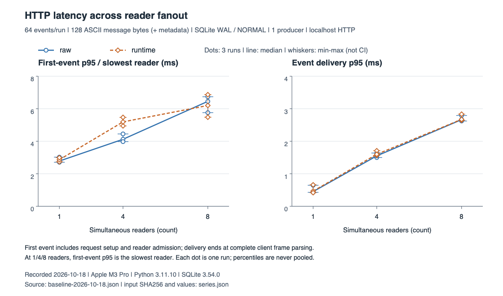
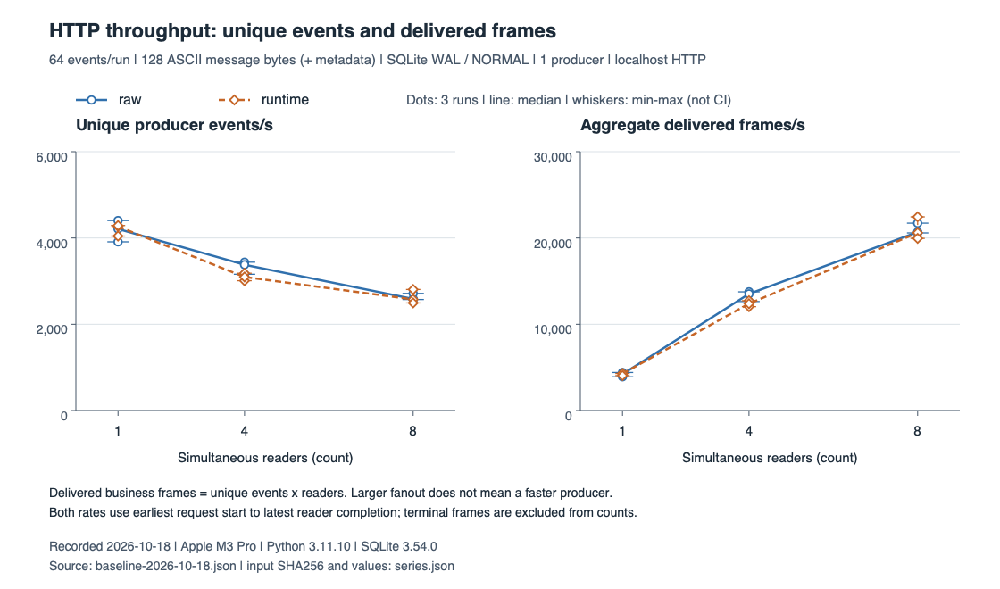
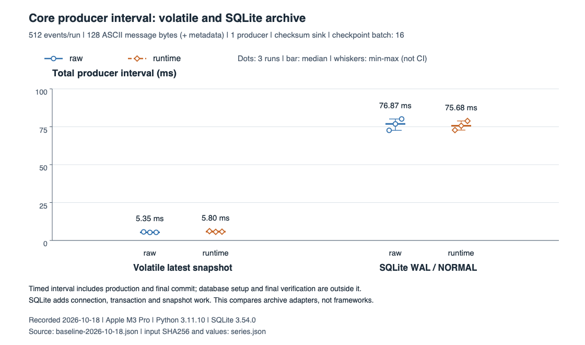

# 性能基线

[English](performance.en.md) · [文档导航](README.md)

这组本机合成突发测试用于观察传输、核心协调与 SQLite 的成本，不代表生产容量或 SLO。

## 结果与适用范围

以单个有限任务、128 字节 message（另含 JSON/SSE 元数据）、500 ms 更新周期（2 Hz）、最多 8 个本机观察者为例，给事件到解析的额外延迟分配周期的 10%，即 **50 ms**，给完整短 worker 分配 **128 MiB** RSS。这是本文选定的工程预算。

9 个 runtime HTTP/SQLite 样本共交付 **2,496** 个有序业务帧和 **39** 个终态，完成时结果均已提交。最坏一次 p99 为 **2.897 ms**（预算的 **5.8%**），所有观测延迟最大 **2.956 ms**；runtime HTTP 峰值 RSS 最大 **56.375 MiB**。这些短突发满足上述传输和内存预算。

实际 Demo 的持续 2 Hz / 8 人接入、长期内存增长、浏览器与远端网络、计算及恢复耗时仍需单独验收。Demo 的 backlog=5、checkpoint=3；基准为 backlog=8、无 pacing、checkpoint=16。基准的 512/64 事件均整除 checkpoint=16，未覆盖 finish 时尚有业务 pending 的耗时。

## 图 1：读者增加时的延迟



横轴为实测 **1、4、8** 个读者，纵轴为 **ms，越低越好**。点为三次原始结果，中线为中位数，须线为 min–max；连线只引导读图。每次仅有 1/4/8 个首帧观察值，首帧 p95 等于最慢观察者；delivery p95 属于各次样本，未合并统计。

此参考路径的延迟随读者增加而上升，raw/runtime 范围大体接近。每个读者都需编码、发送和解析帧；调度、编码、队列各占多少尚无 profiler 证据。

## 图 2：唯一事件与总投递吞吐



横轴为读者数；左图为**唯一业务事件/秒**，右图为**投递业务帧/秒**，分母均为最早请求至最后读者结束的完整波次。一个事件投给 8 人计 8 帧，终态不计入分子。数值越高，表示此固定负载完成得越快。

runtime 中位数依次为 **4,266 → 3,096 → 2,575 events/s** 和 **4,266 → 12,383 → 20,600 frames/s**。总投递增长包含 fanout 乘数，不代表生产者随并发增加而变快。

## 图 3：SQLite 与临时内存的成本



纵轴为相同 **512 个事件的生产区间 ms，越低越好**；保留三次原始点与中位数/min–max。runtime 中位数由临时内存的 **5.80 ms** 变为 SQLite 的 **75.68 ms**，两组中位数之比约 **13.1×**；raw/runtime 的 SQLite 范围重叠。

每 16 条打开连接并提交 checkpoint，约 6.25% 的 send 因而包含连接、编码与事务工作，p50 仍在微秒级，p95 则包含毫秒级工作。13.1× 是所选存储路径的整体成本，未分解磁盘、缓存、SQLite、编码与锁的贡献。

## 数据来源与复现

全部 **36** 个样本保存在[原始 JSON](../benchmarks/results/baseline-2026-10-18.json)：2026-10-18，Python 3.11.10、SQLite 3.54.0、Apple M3 Pro（12 逻辑 CPU、36 GiB）、arm64、macOS 27.0.1；可选编码依赖为 Pydantic 2.10.4、sse-starlette 3.2.0。

这是不可变[源码 `7248096`](https://github.com/0RAJA/ui-stream/tree/72480966c9bb154362b2a378ec24eab633205f7b) 对应的历史 macOS 测量，保留原始字节与源码摘要，不代表后续代码的重测或 Linux 实测。[派生序列](performance-figures/series.json)保留原值、统计口径和原文件 SHA256；每张 PNG 均有同名 SVG。

在仓库根目录使用已安装核心包的 Python 环境运行；脚本不自动安装依赖，benchmark、Demo 和示例不进入 wheel/sdist。新测量写入独立文件，勿覆盖历史基线。

```bash
python -m benchmarks.run --smoke --output benchmarks/results/smoke-local.json
python -m benchmarks.run --output benchmarks/results/baseline-local.json
python -m unittest tests.test_benchmarks -v
```

以下可选绘图工具需要已有 ReportLab；macOS 用系统 `sips` 导出 PNG，无 `sips` 时仍生成 SVG。`--pdf-output` 可将 PDF 导向仓库外；核心、Demo 和基准运行不需要 ReportLab。

```sh
python -m benchmarks.plot --input benchmarks/results/baseline-2026-10-18.json --output docs/performance-figures
```

## 负载与对照

| 层次 | 负载 | 持久化 | 对照 |
| --- | --- | --- | --- |
| core | 512 个 progress 事件、128 字节 ASCII 文本字段（另含元数据）、单生产者、同步帧摘要接收器 | 临时内存 / SQLite 最新快照 | `StreamRuntime` / raw loop |
| SSE 编码 | 512 个相同 compact JSON、`id: <step>-0`、LF 帧 | 无网络、flush 或存储 | ui-stream JSON/SSE profile / 已安装的 sse-starlette `ServerSentEvent` |
| HTTP + SQLite | 64 个事件、单生产者、localhost 1/4/8 个读取连接 | 最新快照；尾部、终态与结果原子提交 | 同一宿主与适配器的 runtime / raw 生产者 |

raw/runtime 使用相同 codec、live/archive JSON 编码、游标、每事件一次帧接收、16 条一批 checkpoint，以及 commit 后发布终态的顺序。摘要、数量、批次与结果校验工作量；raw 省去锁、容量判断、完整性状态与恢复，不具备同等故障保障。

SQLite 每个样本新建临时库，只保留最新快照；每次 checkpoint 使用独立连接与短事务，最终结果原子提交。使用 WAL，历史结果记录实际 `synchronous=1`（NORMAL），这不等于 FULL 断电持久性，断电可能丢失已提交事务，见 [SQLite 同步语义](https://www.sqlite.org/pragma.html#pragma_synchronous)。core 建表、创建 execution 与最终校验不计入生产区间；临时内存值随进程退出丢失。

HTTP 复用 Demo 的真实 handler、MemoryChannel 和 SQLite repository，由基准生成合成事件，不运行有间隔的 `DemoService` 或其四任务准入限制。全部读者就绪后才生产，每帧 flush，断言每人收到有序业务帧与一次终态。结果覆盖单进程标准库宿主、本机客户端与 SQLite。

## 指标口径

- **首事件**：core/编码为首次同步操作完成；HTTP 为请求开始至解析首个业务帧，包含连接与就绪屏障，不含心跳。
- **延迟**：`send_ns` 包含同步 checkpoint；HTTP `delivery_ns` 从 `send()` 前构造事件至客户端解析完整帧，使用同一单调时钟，包含排队、编码、socket 和解析。
- **分位数**：各样本独立计算 nearest-rank p50/p95/p99，三次重复不合并、不平均分位数。core 首事件每次仅一个观测，三个分位相同。
- **吞吐**：core/编码以生产区间为分母；HTTP 以完整波次为分母，同时报告唯一事件和投递帧（事件数 × 读者）。终态计入耗时，不计入分子。
- **内存/磁盘**：新 worker 的峰值 RSS 含解释器、可选模块、SQLite、服务端和本机客户端，不是 core 增量；`database_bytes` 为结束时数据库/WAL 大小，不是总写入或峰值。

## 资源上限与局限

每组重复三次，每次新建子进程，交替正序/逆序，无单独预热或逐事件 sleep。首操作冷启动，后续自然热身，有限突发用于观察排队。

硬上限：core/编码 1,000 条、HTTP 256 条、8 个读者、正文 4,096 字节、3 档连接数、3 次重复。worker 最长 30 秒墙钟、15 秒 CPU、128 文件描述符；Linux 地址空间限 512 MiB，suite 120 秒后停止调度。macOS 由负载、读者与 channel 容量约束内存，未施加地址空间限制。smoke 为 16 个 core/HTTP 事件、1 连接、2 次重复；测试无机器速度阈值。

当前 Linux launcher 在 Python 启动前为子环境设 `MALLOC_ARENA_MAX=2`，限制 glibc arena 预留，保留 512 MiB 上限和 1/4/8 读者覆盖，见 [GNU libc 说明](https://sourceware.org/glibc/manual/latest/html_node/Memory-Allocation-Tunables.html)。新结果的 `worker_limits` 记录实际限制与 allocator 环境；历史 macOS JSON 早于这些字段。

仅使用合成数据与 loopback，临时库自动删除。JSON 记录环境版本和相对源码 AST 摘要，不含主机名、用户名、解释器绝对位置或本机路径。

只测一台机器、短 ASCII 突发、单写入者；未测 TLS、代理、浏览器、Redis 服务、远端数据库、多进程广播或慢客户端故障，未清空 SQLite/内核缓存。调度、电源/温度与其他应用会影响结果；三次短测不足以建立置信区间、尾 SLO、饱和容量或生产资源规划。

只有已安装的 sse-starlette 3.2.0 参与等价字节编码比较；本报告不测 ASGI 网络或排列框架性能。[方案选型](comparison.md)另按职责与恢复边界比较相关工具。
